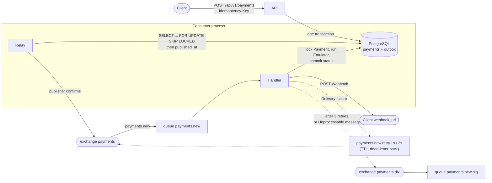

# Async payment processing service

A microservice that takes payment requests, processes them asynchronously through an emulated payment gateway and reports the result to the client by Webhook. It is the hh.ru test task: a FastAPI API, a FastStream (RabbitMQ) consumer and PostgreSQL, tied together with the outbox pattern, an idempotent create endpoint, broker-level retries and a dead-letter queue.

The client `POST`s a Payment and gets `202` at once. A background pipeline runs the Emulator (2-5 s, 90% success), stores the final status and POSTs a Webhook. A retried HTTP request never creates a second Payment, and an accepted Payment is not lost if the API, the broker, the consumer or the client's endpoint fails along the way.

Vocabulary is defined in [`GLOSSARY.md`](GLOSSARY.md); decisions are in [`docs/adr/`](docs/adr).

## Architecture



1. The API writes the Payment (`pending`) and an Outbox event in one transaction.
2. The Relay, an asyncio task inside the consumer, publishes unpublished Outbox events to the `payments` exchange and sets `published_at`.
3. The `payments.new` handler locks the Payment, runs the Emulator if it is still `pending`, commits `succeeded` or `failed` and POSTs the Webhook.
4. A Delivery failure goes through the Retry queues (1 s, 2 s, 4 s) back to `payments.new`; after that, to the DLQ.

## Quick start

Needs Podman (default) or Docker, with a compose provider: `podman compose` delegates to `docker-compose` or `podman-compose`, so install one of them. The first build takes a while (image pulls and dependency install).

```bash
# Podman (macOS: `podman machine start` first; scripts/compose tells you if it is stopped)
scripts/compose up --build -d

# Docker
CONTAINER_ENGINE=docker scripts/compose up --build -d
# or simply: docker compose up --build -d

scripts/compose logs -f consumer     # follow a service's logs
```

`scripts/compose` is a thin wrapper around `podman compose` (or `docker compose` if Podman is missing). No setup or `.env` file is needed; every setting has a dev default.

If image pulls (or the tests) fail with `docker-credential-desktop not installed`, remove the leftover `"credsStore": "desktop"` line from `~/.docker/config.json`, or point `DOCKER_CONFIG` at a directory with a clean `config.json`.

`up` starts `postgres`, `rabbitmq`, a one-shot `migrate` (Alembic), `api` and `consumer`.

| What | Where |
|---|---|
| API | http://localhost:8000 (`GET /health` is the only open endpoint; `/docs`, `/redoc` and `/openapi.json` need `X-API-Key` too, so use curl or a header-injecting browser extension) |
| RabbitMQ management UI | http://localhost:15672 (guest / guest) |
| API key (dev default) | `X-API-Key: dev-api-key` |

### Demo profile

```bash
scripts/compose --profile demo up --build -d
```

adds `webhook-sink`, a tiny app that logs every request it receives as a JSON line and answers `200`, or `500` when the URL has `?fail=1`. Reach it from the consumer as `http://webhook-sink:9000/hook`; read what it received with `scripts/compose logs webhook-sink`. Stop and wipe everything with `scripts/compose --profile demo down -v`.

## Try it

Run the stack with the demo profile first. The examples below were run against it; timestamps and ids differ on your machine.

```bash
H='X-API-Key: dev-api-key'
BODY='{"amount": "10.50", "currency": "USD", "description": "Order 42", "metadata": {"order_id": 42}, "webhook_url": "http://webhook-sink:9000/hook"}'
```

**Create.** Returns at once, status `pending`:

```bash
curl -i -X POST localhost:8000/api/v1/payments -H "$H" \
  -H 'Idempotency-Key: order-42' -H 'Content-Type: application/json' -d "$BODY"
# HTTP/1.1 202 Accepted
# {"payment_id":"33c390c8-fdae-4de6-a733-5dbe28f35f97","status":"pending","created_at":"2026-11-10T10:40:44.494548Z"}
```

**Idempotent repeat.** Same key, same body: the same response and no new Payment:

```bash
curl -i -X POST localhost:8000/api/v1/payments -H "$H" \
  -H 'Idempotency-Key: order-42' -H 'Content-Type: application/json' -d "$BODY"
# HTTP/1.1 202 Accepted
# {"payment_id":"33c390c8-fdae-4de6-a733-5dbe28f35f97","status":"pending","created_at":"2026-11-10T10:40:44.494548Z"}
```

(Repeated after processing, the `status` is the current one.)

**Same key, different body.** Conflict:

```bash
curl -i -X POST localhost:8000/api/v1/payments -H "$H" \
  -H 'Idempotency-Key: order-42' -H 'Content-Type: application/json' \
  -d '{"amount": "99.00", "currency": "USD", "description": "Order 42", "metadata": {"order_id": 42}, "webhook_url": "http://webhook-sink:9000/hook"}'
# HTTP/1.1 409 Conflict
# {"detail":"Idempotency-Key was already used with a different request body"}
```

**Get.** After 2-5 s the Payment is final (`succeeded` 90% of the time, otherwise `failed`):

```bash
curl localhost:8000/api/v1/payments/33c390c8-fdae-4de6-a733-5dbe28f35f97 -H "$H"
# {"payment_id":"33c390c8-...","amount":"10.50","currency":"USD","description":"Order 42","metadata":{"order_id":42},
#  "status":"succeeded","webhook_url":"http://webhook-sink:9000/hook","created_at":"...","processed_at":"2026-11-10T10:40:49.592626Z"}
```

**Watch the Webhook** in the sink's log:

```bash
scripts/compose logs webhook-sink | grep received
# webhook-sink-1  | {"timestamp": "...", "level": "INFO", "logger": "webhook_sink", "message": "received", "method": "POST", "path": "/hook", "query": "", "body": {"payment_id": "33c390c8-...", "status": "succeeded", "amount": "10.50", "currency": "USD", "processed_at": "2026-11-10T10:40:49.592626Z", "metadata": {"order_id": 42}}}
```

**Force retries and the DLQ.** Point the Webhook at the failing sink URL (`?fail=1`):

```bash
curl -X POST localhost:8000/api/v1/payments -H "$H" -H 'Idempotency-Key: fail-1' \
  -H 'Content-Type: application/json' \
  -d '{"amount": "5.00", "currency": "EUR", "description": "Always fails", "webhook_url": "http://webhook-sink:9000/hook?fail=1"}'
```

After the Emulator finishes, the sink receives the same Webhook three times, about 1 s and 2 s apart (the first attempt plus two retries), each answered `500`. The consumer logs each step:

```bash
scripts/compose logs consumer | grep -E 'retrying|giving up'
# ... WARNING ... "delivery failure on attempt 1; retrying via payments.new.retry.1s"
# ... WARNING ... "delivery failure on attempt 2; retrying via payments.new.retry.2s"
# ... ERROR   ... "giving up after attempt 3; parking in the DLQ"
```

The message is now in the DLQ, visible in the management UI (Queues, `payments.new.dlq`) or through its API (counts there lag by a few seconds):

```bash
curl -s -u guest:guest localhost:15672/api/queues/%2F/payments.new.dlq | python3 -c 'import sys,json;d=json.load(sys.stdin);print(d["name"],d["messages"])'
# payments.new.dlq 1

curl -s -u guest:guest -X POST localhost:15672/api/queues/%2F/payments.new.dlq/get \
  -H 'content-type: application/json' -d '{"count":1,"ackmode":"ack_requeue_true","encoding":"auto"}'
# [{... "headers":{"x-attempt":3,"x-last-error":"DeliveryFailure: webhook to http://webhook-sink:9000/hook?fail=1 returned 500"},
#   "payload":"{\"payment_id\":\"02676879-...\"}", ...}]
```

The Payment itself is already `succeeded` (or `failed`): only the Webhook is stuck.

**Other errors.** No `Idempotency-Key` gives `422`; a missing or wrong `X-API-Key` gives `401`; an unknown payment id gives `404`.

## API

Every endpoint needs `X-API-Key` except `/health`, which stays open for container healthchecks. That includes `/docs`, `/redoc` and `/openapi.json`; Swagger UI fetches `openapi.json` without the header, so a browser cannot open them without an extension that injects it (curl works: `curl localhost:8000/openapi.json -H "$H"`).

| Endpoint | Request | Success | Errors |
|---|---|---|---|
| `POST /api/v1/payments` | Headers: `X-API-Key`, `Idempotency-Key` (required, 1-255 chars). Body: `amount` (decimal, > 0, at most 2 places), `currency` (`RUB`, `USD`, `EUR`), `description` (1-255 chars), `metadata` (JSON object, default `{}`), `webhook_url` (HTTP(S) URL, not `localhost` or a literal blocked IP) | `202` `{"payment_id", "status", "created_at"}` | `401` bad or missing key; `409` same key, different body; `422` invalid body, blocked `webhook_url` host or missing `Idempotency-Key` |
| `GET /api/v1/payments/{payment_id}` | Header: `X-API-Key` | `200` `{"payment_id", "amount", "currency", "description", "metadata", "status", "webhook_url", "created_at", "processed_at"}` | `401`; `404` unknown id; `422` id is not a UUID |
| `GET /health` | none | `200` `{"status": "ok"}` | none |

- `amount` is a **string** in every response (`"10.50"`), so no precision is lost. Requests may send it as a string or a number.
- `status` is `pending`, `succeeded` or `failed`; `processed_at` is `null` until the Emulator result is committed.
- **Webhook** (POST to `webhook_url`, 2xx = delivered, timeout `WEBHOOK_TIMEOUT`): `{"payment_id", "status", "amount", "currency", "processed_at", "metadata"}`. It is not signed.

## Configuration

Environment variables, read by the API and the consumer. Compose sets the three required ones and forwards every other variable below from your shell when it is set; otherwise the default applies. `API_KEY` is also read from the shell (default `dev-api-key`).

| Variable | Default | Meaning |
|---|---|---|
| `DATABASE_URL` | required (compose sets it) | SQLAlchemy URL, `postgresql+asyncpg://...` |
| `RABBITMQ_URL` | required (compose sets it) | `amqp://...` |
| `API_KEY` | required (compose: `dev-api-key`) | the static `X-API-Key` value; must not be empty or whitespace, or start-up fails |
| `EMULATOR_MIN_DELAY` | `2` | Emulator minimum delay, seconds |
| `EMULATOR_MAX_DELAY` | `5` | Emulator maximum delay, seconds |
| `EMULATOR_SUCCESS_RATE` | `0.9` | probability that the Emulator succeeds; the rest are Declines |
| `RETRY_DELAYS` | `1,2` | seconds before each retry; one Retry queue per entry, and the number of entries is the number of retries |
| `WEBHOOK_TIMEOUT` | `5` | seconds before a Webhook call counts as failed |
| `WEBHOOK_ALLOWED_HOSTS` | empty (compose: `webhook-sink`) | comma-separated hostnames or IPs whose Webhooks skip the Blocked address check |
| `CONSUMER_CONCURRENCY` | `10` | messages one consumer process handles at once (also the RabbitMQ prefetch); the DB pool is this + 2 |
| `GRACEFUL_TIMEOUT` | `30` | seconds the consumer waits on SIGTERM for in-flight messages (the Relay gets up to 5 s first); compose gives it a 45 s `stop_grace_period`, so raise that too if you raise this |
| `RELAY_BATCH_SIZE` | `100` | Outbox events the Relay claims per iteration |
| `RELAY_POLL_INTERVAL` | `0.5` | seconds the Relay sleeps when there is nothing to publish |
| `RELAY_PUBLISH_TIMEOUT` | `5` | seconds a publish may wait for the broker's confirm before it counts as failed and the batch stops |

Compose also reads `POSTGRES_USER`, `POSTGRES_PASSWORD`, `POSTGRES_DB` (default `payments`) from the shell. For a quick demo, e.g. `EMULATOR_MIN_DELAY=0 EMULATOR_MAX_DELAY=0 scripts/compose up -d` makes payments settle instantly.

Both processes log one JSON object per line to stderr, with a `payment_id` field on records about a Payment.

## Tests

```bash
scripts/check     # ruff check, ruff format --check, pyright, pytest
```

The system tests run the real API and consumer against Postgres and RabbitMQ started with testcontainers, on the same engine choice as compose (`CONTAINER_ENGINE`, default Podman; an explicit `DOCKER_HOST` wins). Without a running engine they are skipped, with a reason.

Podman notes:
- On rootless Podman on Linux, testcontainers' Ryuk reaper may fail to start; set `TESTCONTAINERS_RYUK_DISABLED=true`.
- The `docker-credential-desktop not installed` pull failure: see Quick start.

## Design decisions

- **Outbox, one transaction.** The Payment and its Outbox event commit together, so there is never a Payment without an event, and never an event for a Payment that was rolled back. Publishing straight from the API would lose events if it died between commit and publish.
- **The Relay runs inside the consumer** ([ADR-0001](docs/adr/0001-relay-inside-consumer.md)): the task's compose file lists no relay service. It claims rows with `FOR UPDATE SKIP LOCKED`, so more consumer replicas are safe. Published events are kept (`published_at`) as an audit trail.
- **Retries are TTL queues, not sleeps** ([ADR-0002](docs/adr/0002-broker-retry-via-ttl-queues.md)): waiting messages hold no prefetch slot and survive a consumer restart. The attempt number travels in the `x-attempt` header; the DLQ message carries `x-last-error`. The consumer acks the original only after the broker confirms the republish.
- **A Decline is not a failure** ([ADR-0003](docs/adr/0003-decline-is-not-a-failure.md)): `failed` is a normal outcome, sent by Webhook and never retried, so 10% of payments do not clog the DLQ. Only Delivery failures are retried.
- **Idempotency key and Request hash.** The key is unique in the database. The Request hash is a SHA-256 of a canonical JSON of the validated body (sorted keys, `10.5` equals `10.50`, canonical URL), so a replay is recognised even if the JSON is written differently. Same key and same hash returns the original Payment; a different hash returns `409`. Concurrent creates race on the unique constraint: the loser re-reads the winner and applies the same rule, so exactly one Payment exists.
- **An idempotent handler.** The handler locks the Payment with `SELECT ... FOR UPDATE`. If it is already final, it skips the Emulator and only re-sends the Webhook, so a duplicate or retried message never flips the outcome.
- **Unprocessable messages** (malformed body, unknown `payment_id`) go straight to the DLQ without retries.
- **API key scope.** "X-API-Key for all endpoints" is taken literally: only `/health` stays open (container healthchecks). `/docs`, `/redoc` and `/openapi.json` are served behind the key.
- **Attempts.** "Retry: 3 attempts / DLQ after 3 attempts" is read as 3 Webhook calls in total: the first attempt plus retries after 1 s and 2 s (`RETRY_DELAYS=1,2`), then the DLQ. More delays mean more retries.
- **Durable topology, declared by the consumer on start**: exchanges `payments` and `payments.dlx`, queues `payments.new`, `payments.new.retry.{1s,2s}` and `payments.new.dlq`.

## Guarantees and trade-offs

- **At least once to the broker.** A crash between publishing an event and marking `published_at` re-publishes it. The handler absorbs duplicates.
- **Webhook URLs cannot reach internal hosts.** The consumer resolves the Webhook host at send time and refuses it (Unprocessable: straight to the DLQ, reason in `x-last-error`) if any address is a Blocked address (loopback, private, link-local, unspecified, multicast, reserved). The request then goes to the checked IP with the original `Host` header and, for HTTPS, the original name for SNI and certificate verification, so DNS rebinding cannot swap the address. Only the first checked address is tried; a DNS failure is an ordinary Delivery failure. `WEBHOOK_ALLOWED_HOSTS` skips the check for exact hosts (the demo allowlists `webhook-sink`). The API also answers `422` for `localhost` and literal Blocked IPs. Logs and `x-last-error` show the URL without userinfo and with the query as `?…`; the stored Payment keeps the URL as given.
- **At least once Webhooks.** A Webhook may arrive more than once (a retry after a timeout the client actually processed, a duplicate message). **Receivers must dedupe on `payment_id`.** The Webhook is not signed.
- **Relay polling latency.** Events are picked up by polling, up to `RELAY_POLL_INTERVAL` (0.5 s) after commit, instead of being pushed.
- **Emulator inside the row lock.** The Payment row is locked for the whole Emulator delay (2-5 s), which is what makes duplicate handling safe, at the cost of one pooled DB connection per in-flight message. That is why the pool is `CONSUMER_CONCURRENCY + 2`.
- **A Payment can stay `pending` in the DLQ** if its status commit failed on every attempt (a DB outage). The API shows it as `pending`; re-driving is manual (below) and there is no sweeper.
- **Retry delays are fixed by the Retry queues.** Changing `RETRY_DELAYS` creates new queues and leaves the old ones on the broker; their messages still dead-letter back, and they can be deleted once empty.
- **One static API key**, no per-client keys, rate limiting or listing/searching of Payments.

## Re-driving the DLQ (manual)

Once the cause is fixed, take exactly one message off the DLQ and publish its body again to the `payments` exchange with routing key `payments.new`. Publish it without the `x-attempt` header, so it starts again at attempt 1 (moving the message as is would keep `x-attempt: 3` and send it straight back to the DLQ). The handler is idempotent: re-driving a message whose Payment is already final only re-sends its Webhook.

```bash
# 1. Take one message off the DLQ (acked and removed); note its payload
curl -s -u guest:guest -X POST localhost:15672/api/queues/%2F/payments.new.dlq/get \
  -H 'content-type: application/json' -d '{"count":1,"ackmode":"ack_requeue_false","encoding":"auto"}'
# [{... "payload":"{\"payment_id\":\"<payment_id>\"}", ...}]

# 2. Publish that payload again
curl -s -u guest:guest -X POST localhost:15672/api/exchanges/%2F/payments/publish \
  -H 'content-type: application/json' \
  -d '{"properties":{"delivery_mode":2},"routing_key":"payments.new","payload":"{\"payment_id\":\"<payment_id>\"}","payload_encoding":"string"}'
# {"routed":true}
```

Note: the management API's message counts lag by a few seconds, so a queue may briefly show a stale number.

## Possible extensions

- HMAC signing of Webhooks (a shared secret per client and a signature header), so receivers can verify the sender.
- A sweeper that re-drives the DLQ, or re-enqueues `pending` Payments older than a threshold.
- Metrics and tracing (Prometheus, OpenTelemetry), a trace id from the HTTP request through the Outbox event to the Webhook.
- Per-client API keys and rate limiting; listing and searching Payments.
- Push-based Relay wake-up (e.g. `LISTEN/NOTIFY`) to remove the polling latency.
